<!--
  dev-Aatif // Dual-Theme Kinetic Engineering Monograph
  Automatically adapts between Darkroom (GitHub Dark) and Archival Vellum (GitHub Light).
  Regenerate all 30 vector plates anytime with: python3 scripts/generate_plates.py
-->

  <picture>
    <source media="(prefers-color-scheme: dark)" srcset="./assets/hero-dark.svg" />
    <source media="(prefers-color-scheme: light)" srcset="./assets/hero-light.svg" />
    
  </picture>

 

  <picture>
    <source media="(prefers-color-scheme: dark)" srcset="./assets/divider-01-dark.svg" />
    <source media="(prefers-color-scheme: light)" srcset="./assets/divider-01-light.svg" />
    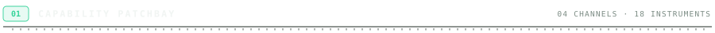
  </picture>

  <picture>
    <source media="(prefers-color-scheme: dark)" srcset="./assets/patchbay-dark.svg" />
    <source media="(prefers-color-scheme: light)" srcset="./assets/patchbay-light.svg" />
    
  </picture>

<code>▸ &nbsp;Open plain-text specification table</code>

 

| Surface | Stack |
| :--- | :--- |
| **Mobile** | Dart, Flutter, Riverpod, Kotlin, Jetpack Compose, Material 3 |
| **Web and desktop** | TypeScript, JavaScript, React, Next.js, Tailwind CSS, Electron |
| **Backend and data** | Python, Node.js, Express, PostgreSQL, SQLite |
| **Version control** | Git |

 

  <picture>
    <source media="(prefers-color-scheme: dark)" srcset="./assets/divider-02-dark.svg" />
    <source media="(prefers-color-scheme: light)" srcset="./assets/divider-02-light.svg" />
    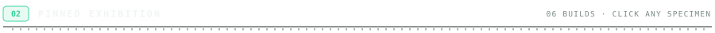
  </picture>

  <a href="https://github.com/dev-Aatif/Pixel-Forge">
    <picture>
      <source media="(prefers-color-scheme: dark)" srcset="./assets/cards/pixel-forge-dark.svg" />
      <source media="(prefers-color-scheme: light)" srcset="./assets/cards/pixel-forge-light.svg" />
      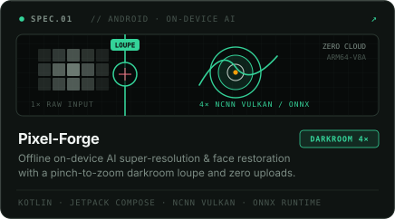
    </picture>
  </a>
  <a href="https://github.com/dev-Aatif/sarmaya">
    <picture>
      <source media="(prefers-color-scheme: dark)" srcset="./assets/cards/sarmaya-dark.svg" />
      <source media="(prefers-color-scheme: light)" srcset="./assets/cards/sarmaya-light.svg" />
      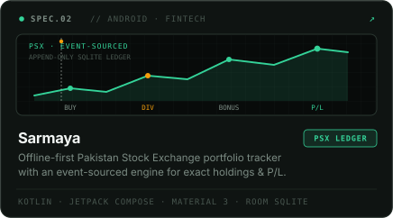
    </picture>
  </a>

  <a href="https://github.com/dev-Aatif/Hayya">
    <picture>
      <source media="(prefers-color-scheme: dark)" srcset="./assets/cards/hayya-dark.svg" />
      <source media="(prefers-color-scheme: light)" srcset="./assets/cards/hayya-light.svg" />
      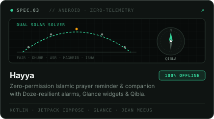
    </picture>
  </a>
  <a href="https://github.com/dev-Aatif/nebula-downloader">
    <picture>
      <source media="(prefers-color-scheme: dark)" srcset="./assets/cards/nebula-dark.svg" />
      <source media="(prefers-color-scheme: light)" srcset="./assets/cards/nebula-light.svg" />
      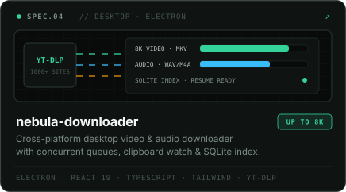
    </picture>
  </a>

  <a href="https://github.com/dev-Aatif/Ergo">
    <picture>
      <source media="(prefers-color-scheme: dark)" srcset="./assets/cards/ergo-dark.svg" />
      <source media="(prefers-color-scheme: light)" srcset="./assets/cards/ergo-light.svg" />
      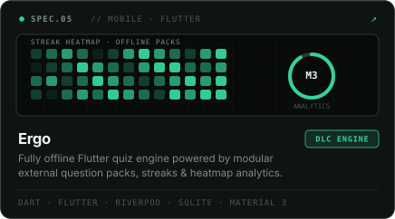
    </picture>
  </a>
  <a href="https://github.com/dev-Aatif/jot">
    <picture>
      <source media="(prefers-color-scheme: dark)" srcset="./assets/cards/jot-dark.svg" />
      <source media="(prefers-color-scheme: light)" srcset="./assets/cards/jot-light.svg" />
      
    </picture>
  </a>

<code>▸ &nbsp;Open full architectural dossier (all 6 pinned builds)</code>

 

| Specimen | Surface | Core Architecture |
| :--- | :--- | :--- |
| [**Pixel-Forge**](https://github.com/dev-Aatif/Pixel-Forge) | Android (`arm64-v8a`) | Offline 2×/4× AI upscaling & portrait restoration via ONNX Runtime (QNN/NNAPI) and NCNN Vulkan with an indie darkroom Material 3 split-loupe and zero cloud uploads. |
| [**Sarmaya**](https://github.com/dev-Aatif/sarmaya) | Android | Offline-first Pakistan Stock Exchange (PSX) portfolio tracker built in Kotlin & Jetpack Compose around an append-only event-sourced Room/SQLite ledger for deterministic holdings and realized P/L. |
| [**Hayya**](https://github.com/dev-Aatif/Hayya) | Android | 100% offline, zero-telemetry spiritual companion featuring dual astronomical solar solvers (`adhan` + Jean Meeus), Doze-resilient exact alarms, 5 Glance widgets, mosque auto-silent, and Qibla compass. |
| [**nebula-downloader**](https://github.com/dev-Aatif/nebula-downloader) | Desktop (Win / Linux) | Cross-platform Electron + React 19 + TypeScript desktop wrapper over `yt-dlp` with up to 8K extraction, concurrent resumable queues, clipboard link detection, and an isolated SQLite index. |
| [**Ergo**](https://github.com/dev-Aatif/Ergo) | Mobile (Flutter) | Offline-first Flutter + Riverpod quiz engine powered by downloadable external question packs, SQLite persistence, audio feedback, and a heatmap + chart analytics suite. |
| [**jot**](https://github.com/dev-Aatif/jot) | Shell / TUI | Zero-dependency, local-first personal knowledge base in pure Rust backed by SQLite FTS5, idling under 10 MB RAM with a three-pane interactive TUI and instant shell capture. |

Browse all repositories at [github.com/dev-Aatif?tab=repositories](https://github.com/dev-Aatif?tab=repositories).

 

  <picture>
    <source media="(prefers-color-scheme: dark)" srcset="./assets/divider-03-dark.svg" />
    <source media="(prefers-color-scheme: light)" srcset="./assets/divider-03-light.svg" />
    
  </picture>

  <a href="mailto:Aatif.biz@protonmail.com">
    <picture>
      <source media="(prefers-color-scheme: dark)" srcset="./assets/channel-email-dark.svg" />
      <source media="(prefers-color-scheme: light)" srcset="./assets/channel-email-light.svg" />
      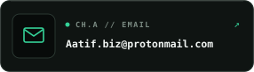
    </picture>
  </a>
  <a href="https://www.linkedin.com/in/dev-aatif/">
    <picture>
      <source media="(prefers-color-scheme: dark)" srcset="./assets/channel-linkedin-dark.svg" />
      <source media="(prefers-color-scheme: light)" srcset="./assets/channel-linkedin-light.svg" />
      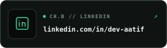
    </picture>
  </a>
  <a href="https://dev-aatif.vercel.app/">
    <picture>
      <source media="(prefers-color-scheme: dark)" srcset="./assets/channel-portfolio-dark.svg" />
      <source media="(prefers-color-scheme: light)" srcset="./assets/channel-portfolio-light.svg" />
      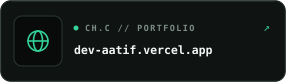
    </picture>
  </a>

  Reach me by <a href="mailto:Aatif.biz@protonmail.com">email</a>, on <a href="https://www.linkedin.com/in/dev-aatif/">LinkedIn</a>, or at <a href="https://dev-aatif.vercel.app/">dev-aatif.vercel.app</a>.

 

  <picture>
    <source media="(prefers-color-scheme: dark)" srcset="./assets/colophon-dark.svg" />
    <source media="(prefers-color-scheme: light)" srcset="./assets/colophon-light.svg" />
    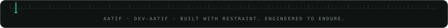
  </picture>

