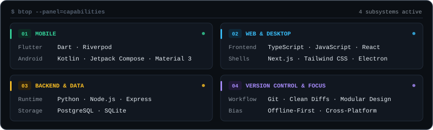
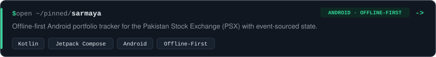
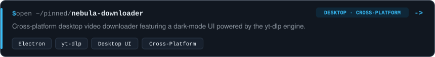
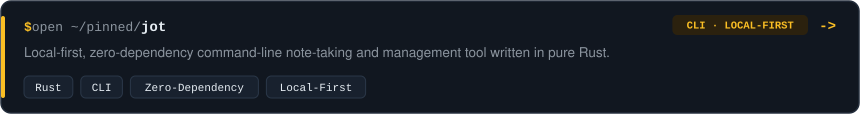
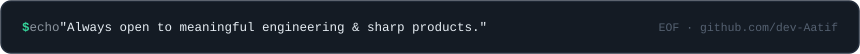

<div align="center">

<picture>
  <source media="(prefers-color-scheme: dark)" srcset="./assets/hero-dark.svg" />
  <source media="(prefers-color-scheme: light)" srcset="./assets/hero-light.svg" />
  
</picture>

</div>

---

### `01 // CAPABILITIES`

<div align="center">

<picture>
  <source media="(prefers-color-scheme: dark)" srcset="./assets/stack-dark.svg" />
  <source media="(prefers-color-scheme: light)" srcset="./assets/stack-light.svg" />
  
</picture>

</div>

<details>
<summary><code>$ cat ~/.config/stack.md</code> — plain-text breakdown</summary>
<br />

| Surface | Tools & Technologies |
| :--- | :--- |
| **Mobile** | Dart, Flutter, Riverpod, Kotlin, Jetpack Compose, Material 3 |
| **Web and desktop** | TypeScript, JavaScript, React, Next.js, Tailwind CSS, Electron |
| **Backend and data** | Python, Node.js, Express, PostgreSQL, SQLite |
| **Version control** | Git |

</details>

---

### `02 // PINNED WORK`

<div align="center">

<a href="https://github.com/dev-Aatif/sarmaya">
  <picture>
    <source media="(prefers-color-scheme: dark)" srcset="./assets/project-sarmaya-dark.svg" />
    <source media="(prefers-color-scheme: light)" srcset="./assets/project-sarmaya-light.svg" />
    
  </picture>
</a>

<a href="https://github.com/dev-Aatif/nebula-downloader">
  <picture>
    <source media="(prefers-color-scheme: dark)" srcset="./assets/project-nebula-dark.svg" />
    <source media="(prefers-color-scheme: light)" srcset="./assets/project-nebula-light.svg" />
    
  </picture>
</a>

<a href="https://github.com/dev-Aatif/jot">
  <picture>
    <source media="(prefers-color-scheme: dark)" srcset="./assets/project-jot-dark.svg" />
    <source media="(prefers-color-scheme: light)" srcset="./assets/project-jot-light.svg" />
    
  </picture>
</a>

</div>

> Explore all repositories: [`github.com/dev-Aatif?tab=repositories`](https://github.com/dev-Aatif?tab=repositories)

---

### `03 // HANDSHAKE`

```text
$ ping dev-aatif --channels
```

- **Email** — [`Aatif.biz@protonmail.com`](mailto:Aatif.biz@protonmail.com)
- **LinkedIn** — [`linkedin.com/in/dev-aatif`](https://www.linkedin.com/in/dev-aatif/)
- **Portfolio** — [`dev-aatif.vercel.app`](https://dev-aatif.vercel.app/)

<br />

<div align="center">

<picture>
  <source media="(prefers-color-scheme: dark)" srcset="./assets/footer-dark.svg" />
  <source media="(prefers-color-scheme: light)" srcset="./assets/footer-light.svg" />
  
</picture>

</div>
